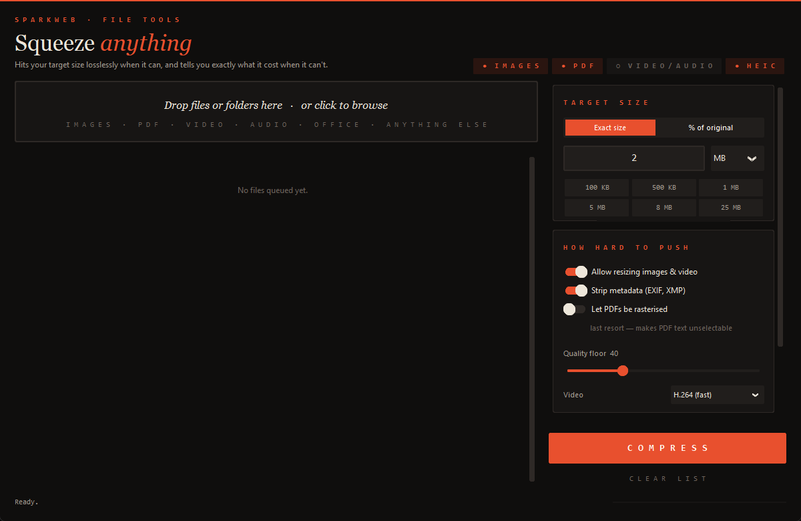

# Squeeze

Desktop app for shrinking files down to a size you pick. Drop files in, type
`500 KB` or `8 MB` (or pick a percentage), hit Compress.

It always tries lossless first and only lowers quality if it has to. When it
does, it tells you how much was lost instead of hiding it.



## Running it

You need Python 3.12. (3.15 currently ships a Tk that hangs on Windows, so the
window never opens.)

```
py -3.12 -m venv .venv
.venv\Scripts\pip install -r requirements.txt
```

Then double-click `Squeeze.bat`, or run:

```
.venv\Scripts\python app.py
```

Video and audio need ffmpeg on your PATH:

```
winget install Gyan.FFmpeg
```

Without it, everything else still works. The badges in the top right show
what's available.

## What happens to each file

Every result is labelled with how it got there:

- **Lossless**: identical content, just stored better.
- **Near-lossless**: re-encoded at full resolution and high quality. You won't
  see a difference.
- **Lossy**: quality or resolution was reduced to hit the target. You get a
  PSNR/SSIM score so you know how much.
- **Unchanged**: nothing beat the original, so it's copied as-is.

If a target can't be reached without wrecking the file, it says so and stops.

### Images

jpg, png, webp, gif, bmp, tiff, heic, avif.

Lossless re-encode first. After that it would rather shrink the resolution a
bit than crank the quality down, since a smaller clean image looks better than
a full-size blocky one. Animated GIF/WebP keep all their frames. Colour
profiles are kept.

### PDF

1. Clean up unused objects, subset fonts, recompress streams (lossless).
2. Recompress only the images inside. Text stays selectable.
3. Turn whole pages into images. Off by default because you lose selectable
   text.

### Video and audio

The bitrate is worked out from target size and duration, then encoded in two
passes so the file actually lands near the target. Nothing gets cut. Resolution
only drops when the bitrate is too low for it. WAV and FLAC try lossless FLAC
first.

### Office files and zips

docx, xlsx, pptx, epub, zip, jar.

Repacked with maximum compression first. If that's not enough, only the images
inside get recompressed, in their original format, so the document still opens
normally.

### Anything else

Gets zipped. If it doesn't compress (already compressed data, for example), you
get the original back instead of a bigger zip.

## Options

- **Allow resizing**: turn off to keep images and video at their original
  resolution.
- **Quality floor**: it won't go below this. Raise it if you'd rather miss the
  target than get a mushy file.
- **Strip metadata**: removes EXIF/XMP.
- **Let PDFs be rasterised**: enables PDF step 3.
- **Video codec**: H.265 makes smaller files than H.264 but encodes a lot
  slower.

Output goes next to the original with a `_small` suffix, or into a folder you
choose. Double-click a finished file to open its location.

## Code layout

```
app.py              UI
squeeze/
  core.py           shared types, size parsing, search
  quality.py        PSNR / SSIM
  pipeline.py       picks the engine for a file
  engines/          image, pdf, media, archive, generic
```

Each engine has `handles()` and `compress()`. To add a format, add an engine.
